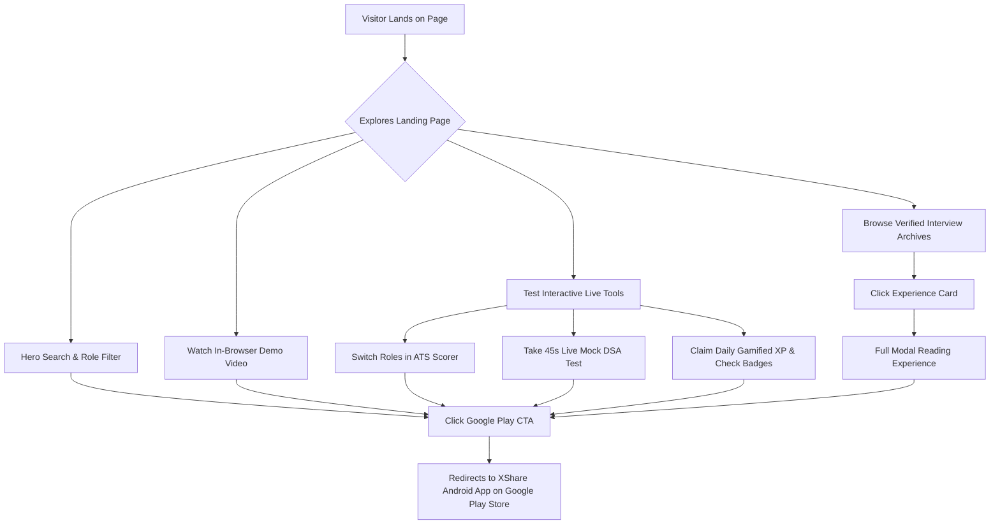

# 🚀 XShare — Landing Page & Career Preparation Platform

> **Where Real-World Tech Experiences Turn Into Career Opportunities.**  
> A high-performance, modern, responsive web application and landing page designed for the **XShare** career ecosystem — bridging candidates with real interview archives, ATS resume auditing, mock testing, and gamified skill learning.

---

## 📌 Table of Contents
- [Overview](#-overview)
- [✨ Key Platform Features](#-key-platform-features)
- [🎮 Interactive Live Demo Suite](#-interactive-live-demo-suite)
- [🧭 End-to-End User Workflow](#-end-to-end-user-workflow)
- [🎨 Design System & Aesthetics](#-design-system--aesthetics)
- [🤖 UI Design Prompts & AI Architecture](#-ui-design-prompts--ai-architecture)
- [📂 Project Architecture & File Structure](#-project-architecture--file-structure)
- [⚡ Quick Start & Local Development](#-quick-start--local-development)
- [🚀 Deployment & CDN Cache Strategy](#-deployment--cdn-cache-strategy)
- [📱 Mobile Responsiveness Breakdown](#-mobile-responsiveness-breakdown)

---

## 🌟 Overview

**XShare** is an all-in-one preparation and mentorship platform centered on authentic interview experiences from candidates placed at Tier-1 companies (Google, Microsoft, Amazon, Adobe, Zomato, and more).

This repository contains the production landing page featuring rich animations, interactive web widgets (ATS scorer, mock test simulator, gamified quest arena), custom video player controls, and full responsiveness from ultra-compact smartphones (320px) to ultra-wide displays.

---

## ✨ Key Platform Features

1. **Dynamic Navigation & Drawer Menu**:
   - Sticky frosted glass header (`backdrop-filter: blur(12px)`).
   - Official brand logo integration.
   - Smooth animated mobile slide-out drawer navigation without horizontal layout shifts.

2. **Hero Search & Real-Time Role Chips**:
   - Interactive search bar with instant filter triggers (`SDE-1`, `Frontend`, `Data Science`, `System Design`, `Google`, `Amazon`).
   - Animated status badge and dual call-to-action buttons.

3. **Interactive Browser Video Showcase**:
   - Browser chrome frame mockup with traffic light dots and simulated secure URL bar.
   - Embedded showcase video with interactive audio unmute overlays, floating play badges, and autoplay gesture listeners.

4. **Live Key Performance Indicators (5 Metric Cards)**:
   - **50,000+** Active Students & Job Seekers.
   - **1,200+** Verified Company Interview Experiences.
   - **94%** Interview Placement Success Rate.
   - **₹48 LPA** Highest Candidate Package Offered.
   - **3,000+** Curated Project & Problem Ideas.

5. **Modern Gradient Card Feature Pillars**:
   - **Verified Interview Experiences**: In-depth round-by-round breakdown (OA, Technical DSA, System Design, HR).
   - **ATS Resume Scorer**: AI keyword extraction and ATS format verification.
   - **Curated Tech Jobs & Off-Campus Drives**: Verified hiring openings from seed startups to Fortune 500s.
   - **Live Mock Challenges**: Timed assessments with detailed score analytics.
   - **Gamified Education Arena**: Daily streaks, XP multiplier quests, and leaderboard trophies.
   - **Verified Peer Community**: 1-on-1 mentorship connections and discussion boards.

6. **Interactive Experience Archive & Filter Hub**:
   - Live filtering by company (Google, Microsoft, Amazon, Adobe, Zomato, Flipkart) and category.
   - Modal reading overlay for deep dive into interview questions, coding rounds, and interview tips.

7. **Official Google Play Store Showcase**:
   - Warm cream theme (`.btn-cream`) download button with authentic 4-color Google Play vector badge.
   - Single-click deep linking to the Google Play Store Android app.

---

## 🎮 Interactive Live Demo Suite

The landing page provides 3 interactive live simulation tools so visitors can experience XShare before downloading:

```
┌───────────────────────────────┬───────────────────────────────┬───────────────────────────────┐
│  📄 ATS Resume Health Score   │   💻 Quick Mock Test Quiz     │    🎮 Gamified Education      │
├───────────────────────────────┼───────────────────────────────┼───────────────────────────────┤
│ • Role Switcher (SDE, ML, PM) │ • 45s Countdown Timer         │ • 7-Day Streak Tracker        │
│ • Live ATS Score Gauge (96%)  │ • Interactive Option Buttons  │ • Daily Quests with Progress  │
│ • Keyword & Metric Audit      │ • Instant Answer Validation   │ • Unlocked Skill Badges       │
│ • Actionable Recommendation   │ • +25 XP Toast Award Engine   │ • Live Rank Leaderboard       │
└───────────────────────────────┴───────────────────────────────┴───────────────────────────────┘
```

---

## 🧭 End-to-End User Workflow



---

## 🎨 Design System & Aesthetics

| Token / Element | Value | Description |
| :--- | :--- | :--- |
| **Primary Brand Blue** | `#2563EB` | Vibrant tech blue for primary buttons & focus states |
| **Electric Indigo / Purple** | `#8B5CF6` / `#6366F1` | Accent gradient for gamified badges & quests |
| **Warm Cream CTA** | `#FFFDF8` (Border: `#E2D9C8`) | Distinctive Google Play download button |
| **Success Emerald** | `#059669` / `#ECFDF5` | Gauge match scores and correct quiz answers |
| **Warning Amber** | `#D97706` / `#FEF3C7` | ATS suggestions and active XP multipliers |
| **Error Crimson** | `#DC2626` / `#FEF2F2` | Quiz timer pill and wrong answer alerts |
| **Dark Heading Base** | `#0F172A` / `#1E293B` | High-contrast readable typography |
| **Muted Text** | `#64748B` | Secondary subtitles and audit notes |
| **Primary Typography** | `Plus Jakarta Sans` | Body text, UI labels, buttons |
| **Display Typography** | `Outfit` | Hero headings, section titles, KPI numbers |

---

## 🤖 UI Design Prompts & AI Architecture

To recreate, extend, or generate matching components using AI generative design prompts, use the following structured specifications:

### 1. Hero Section UI Prompt
```text
Create a modern, high-converting hero section for a tech career platform named XShare.
- Visuals: Dark mode accents on clean white glassmorphism background with subtle purple and blue ambient blur orbs.
- Content: Frosted pill tag ("#1 VERIFIED INTERVIEW EXPERIENCES PLATFORM"), large bold typography ("Where Real Experiences Turn Into Tech Careers"), dynamic search bar with company pills (Google, Microsoft, Amazon, SDE, AI).
- Actions: Gradient Primary Button "Explore 1,200+ Experiences" and Cream Play Store Button with authentic vector logo.
- Right Column / Showcase: In-browser frame mockup with video demonstration, audio unmute button, and live floating interactive badges.
```

### 2. Feature Cards UI Prompt (shadcn / Tailwind / Vanilla CSS)
```text
Design a responsive grid of 6 modern gradient cards for a developer platform.
- Visual Style: Clean frosted card with subtle 1px border (#E2E8F0), top corner gradient glowing wash (Purple, Cyan, Green, Amber, Rose, Blue), and decorative background watermark icon.
- Card Elements: Frosted badge with glowing dot, bold title, descriptive copy, 3-item checkmark list with micro-icons, and an arrow hover action.
- Interaction: Smooth translateY(-6px) hover lift with card glow enhancement and icon rotation.
```

### 3. Interactive Live Demo Tools UI Prompt
```text
Build a 3-column interactive live demo component:
Card 1 (ATS Resume Checker): Top gauge displaying "96% ATS Match", role selector tabs (Full Stack SDE, ML, PM), dynamic checklist with green passed ticks and yellow recommendation warning, CTA "Build My Free ATS Resume Now".
Card 2 (Mock Quiz Challenge): Real-time 45s countdown timer badge, data structure question, 4 interactive answer buttons (A, B, C, D) with green/red instant feedback state and celebratory toast notifications.
Card 3 (Gamified Education): "🔥 7d Active Streak" gauge, tab switcher (Daily Quests, Skill Badges, Leaderboard), quest checklist with animated 66% progress bars, interactive "Claim +25 XP" button, and gradient CTA.
```

---

## 📂 Project Architecture & File Structure

```text
xshare_landing page/
├── index.html              # Main semantic HTML5 document with SEO & OpenGraph tags
├── styles.css              # Custom design system, typography, animations & media queries
├── script.js               # Event handlers, animations, quiz logic, filters & modals
├── logo.png                # Brand logo & high-resolution title bar favicon
│
├── components/             # React / shadcn compatible UI component library
│   └── ui/
│       ├── gradient-card.tsx   # Reusable TypeScript Framer Motion gradient card
│       └── demo.tsx            # Standalone React showcase demo
│
├── lib/
│   └── utils.ts            # Zero-dependency TypeScript class merging utility (cn)
│
├── vedio/                  # Embedded app demonstration video assets
│   └── demo_vedio.mp4
│
└── README.md               # Complete platform documentation & developer guide
```

---

## ⚡ Quick Start & Local Development

### Prerequisites
- Any modern web browser (Chrome, Firefox, Safari, Edge).
- Optional: Python, Node.js, or VS Code Live Server extension.

### Running Locally

#### Option A: VS Code Live Server (Fastest)
1. Open the project folder in VS Code.
2. Right-click `index.html` and click **"Open with Live Server"**.

#### Option B: Python Simple HTTP Server
```bash
# Python 3
python -m http.server 3000
```
Open [http://localhost:3000](http://localhost:3000) in your browser.

#### Option C: Node.js `npx serve`
```bash
npx serve .
```

---

## 🚀 Deployment & CDN Cache Strategy

### Deploying to GitHub Pages
1. Ensure your changes are committed:
   ```bash
   git add .
   git commit -m "Update XShare landing page"
   git push origin main
   ```
2. Navigate to **Repository Settings** > **Pages**.
3. Under **Branch**, select `main` and root folder `/`, then click **Save**.

### CDN & Browser Cache-Busting
To ensure users and mobile edge networks instantly receive stylesheet updates without caching old CSS, the stylesheet is linked with a query parameter:
```html
<link rel="stylesheet" href="styles.css?v=2.5">
```
*When making significant CSS modifications, simply increment `v=2.6` in `index.html`.*

---

## 📱 Mobile Responsiveness Breakdown

The stylesheet uses a comprehensive multi-tier media query system:
- **`@media (max-width: 1024px)`**: Switches multi-column card grids to 2-column or single-column stack; tablet drawer adjustments.
- **`@media (max-width: 768px)`**: Collapses desktop navbar into animated mobile hamburger drawer; centers video showcase; compacts hero headings.
- **`@media (max-width: 640px)`**: Tightens interactive card padding (`14px 12px`), scales quiz buttons, compacts KPI cards into a 2x2 grid, eliminates horizontal overflow (`overflow-x: hidden`).
- **`@media (max-width: 380px)`**: Ultra-compact smartphone optimization for smaller screens (iPhone SE, Galaxy Mini).

---

## 📄 License & Attribution
- **Brand & Content**: © 2026 XShare Platform. All Rights Reserved.
- **Application Play Store ID**: `com.xshare.learnshare`
